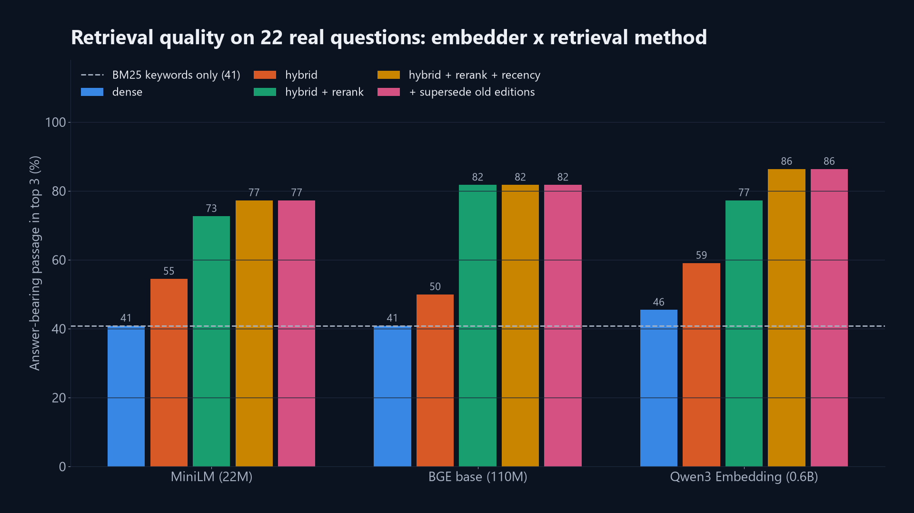
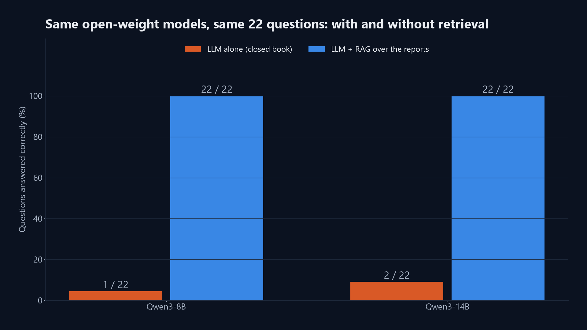

# RAG accuracy report

GeoAI Lab, Series 2 episode 1: *RAG and vector databases*. All numbers are produced by the scripts in `code/` and can be reproduced on one workstation GPU.

## Summary

* **Corpus:** 32 ABARES reports, 1,338 pages, 469,339 words, split into 2,739 chunks (median 307 tokens).
* **Evaluation set:** 22 answerable questions with answers verified against the source page, plus 4 questions the documents cannot answer. Answers are scored automatically: correct only if the exact figure from the report appears in the answer.
* **Retrieval:** best configuration `qwen3-emb|full` puts an answer-bearing passage in the top 3 for 86% of questions and in the top 6 (what the LLM sees) for 96% (MRR 0.83). Keyword search alone: 41% top 3.
* **Qwen3-8B:** 4% correct on its own, **100% correct with RAG**; declined 100% of unanswerable questions with RAG (vs 75% alone).
* **Qwen3-14B:** 9% correct on its own, **100% correct with RAG**; declined 100% of unanswerable questions with RAG (vs 25% alone).
* **Access control:** restricted and internal documents are filtered out before reranking, so a lower-privilege role never has them in the model's context (verified below).

## 1. Retrieval accuracy

Hit@k = a chunk from the gold report that contains the required answer string is among the top k results. MRR = mean reciprocal rank of the first such chunk (0 if not in the top 10).

| Embedder | Method (full = hybrid + rerank + recency + supersede) | Hit@1 | Hit@3 | Hit@6 | Hit@10 | MRR | ms / query |
|---|---|---|---|---|---|---|---|
| - | BM25 keywords | 0.36 | 0.41 | 0.55 | 0.64 | 0.42 | 5 |
| minilm | dense | 0.09 | 0.41 | 0.55 | 0.59 | 0.26 | 12 |
| minilm | hybrid | 0.32 | 0.55 | 0.68 | 0.68 | 0.46 | 9 |
| minilm | hybrid+rerank | 0.59 | 0.73 | 0.82 | 0.82 | 0.66 | 87 |
| minilm | hybrid+rerank+recency | 0.64 | 0.77 | 0.77 | 0.82 | 0.71 | 83 |
| minilm | full | 0.64 | 0.77 | 0.77 | 0.82 | 0.71 | 82 |
| bge-base | dense | 0.27 | 0.41 | 0.55 | 0.59 | 0.37 | 5 |
| bge-base | hybrid | 0.32 | 0.50 | 0.68 | 0.77 | 0.45 | 11 |
| bge-base | hybrid+rerank | 0.64 | 0.82 | 0.86 | 0.91 | 0.73 | 88 |
| bge-base | hybrid+rerank+recency | 0.73 | 0.82 | 0.91 | 0.91 | 0.79 | 88 |
| bge-base | full | 0.73 | 0.82 | 0.91 | 0.91 | 0.79 | 88 |
| qwen3-emb | dense | 0.32 | 0.46 | 0.50 | 0.64 | 0.41 | 35 |
| qwen3-emb | hybrid | 0.41 | 0.59 | 0.68 | 0.82 | 0.53 | 39 |
| qwen3-emb | hybrid+rerank | 0.64 | 0.77 | 0.91 | 0.95 | 0.73 | 114 |
| qwen3-emb | hybrid+rerank+recency | 0.77 | 0.86 | 0.95 | 0.95 | 0.83 | 113 |
| qwen3-emb | **full** | 0.77 | 0.86 | 0.95 | 0.95 | 0.83 | 113 |

**Effect of contextual chunk headers** (title + publication month + page prepended before embedding), hit@3 with hybrid + rerank:

| Embedder | Without headers | With headers |
|---|---|---|
| minilm | 0.82 | 0.73 |
| bge-base | 0.77 | 0.82 |
| qwen3-emb | 0.82 | 0.77 |

Per-question rank of the first answer-bearing chunk (qwen3-emb|full):

| # | Question | Gold report | Rank |
|---|---|---|---|
| 1 | What is ABARES' September 2026 forecast for Australia's national winter crop production in 2026-27? | `abares_crop_report_2026-09.pdf` | 1 |
| 2 | How does the 2026-27 national winter crop forecast compare with the 10-year average? | `abares_crop_report_2026-09.pdf` | 1 |
| 3 | How much wheat is Australia forecast to produce in 2026-27? | `abares_crop_report_2026-09.pdf` | 2 |
| 4 | What is the 2026-27 forecast for Australian barley production? | `abares_crop_report_2026-09.pdf` | 2 |
| 5 | What is the forecast for canola production in 2026-27? | `abares_crop_report_2026-09.pdf` | not in top 10 |
| 6 | What lentil production is forecast for 2026-27? | `abares_crop_report_2026-09.pdf` | 1 |
| 7 | What is Western Australia's winter crop production forecast for 2026-27? | `abares_crop_report_2026-09.pdf` | 1 |
| 8 | Why is Western Australia's winter crop expected to be smaller in 2026-27 than the year before? | `abares_crop_report_2026-09.pdf` | 1 |
| 9 | What is the forecast for national summer crop production in 2026-27? | `abares_crop_report_2026-09.pdf` | 1 |
| 10 | In September 2025, what did ABARES forecast for national winter crop production in 2025-26? | `abares_crop_report_2025-09.pdf` | 6 |
| 11 | What is the forecast gross value of agricultural production in 2026-27? | `abares_ag_commodities_2026-09.pdf` | 1 |
| 12 | What is the forecast value of Australian agricultural exports in 2026-27? | `abares_ag_commodities_2026-09.pdf` | 1 |
| 13 | What share of Australia's water consumption is used by agriculture, fisheries and forestry? | `abares_snapshot_ag_2026.pdf` | 1 |
| 14 | How many broadacre and dairy farm businesses were there in Australia in 2023-24? | `abares_snapshot_ag_2026.pdf` | 1 |
| 15 | By how much did the gross value of agricultural, fisheries and forestry production grow in real terms over the past 20 years? | `abares_snapshot_ag_2026.pdf` | 1 |
| 16 | What was average broadacre farm cash income in 2024-25? | `abares_farm_financial_performance_2026-06.pdf` | 1 |
| 17 | What was the total value of outstanding loans and leases to the Australian farm sector at 30 June 2025? | `abares_agricultural_lending_2024-25.pdf` | 1 |
| 18 | How many new farm loan foreclosures were there in 2024-25? | `abares_agricultural_lending_2024-25.pdf` | 1 |
| 19 | How much has winter rainfall declined in south-western Australia since 1970? | `abares_climate_change_impacts_adaptation_farms.pdf` | 1 |
| 20 | Since 2000, how has the risk of very low farm returns changed compared with 1950 to 2000? | `abares_climate_change_impacts_adaptation_farms.pdf` | 1 |
| 21 | What is ABARES forecasting for Australia's winter crop production in 2026-27, and how does it compare with the 10-year average? | `abares_crop_report_2026-09.pdf` | 1 |
| 22 | How much barley is Western Australia expected to produce in 2026-27? | `abares_crop_report_2026-09.pdf` | 5 |

## 2. Answer accuracy: the same LLMs with and without retrieval

| Model | Correct, LLM alone | Correct, LLM + RAG | Declines unanswerable, alone | Declines unanswerable, RAG | Eval time (s) |
|---|---|---|---|---|---|
| Qwen3-8B | 4% | **100%** | 75% | 100% | 196 |
| Qwen3-14B | 9% | **100%** | 25% | 100% | 242 |

### Qwen3-8B: question by question

| # | Question | Alone | RAG |
|---|---|---|---|
| 1 | What is ABARES' September 2026 forecast for Australia's national winter crop production in 2026-27? | ❌ | ✅ |
| 2 | How does the 2026-27 national winter crop forecast compare with the 10-year average? | ❌ | ✅ |
| 3 | How much wheat is Australia forecast to produce in 2026-27? | ❌ | ✅ |
| 4 | What is the 2026-27 forecast for Australian barley production? | ❌ | ✅ |
| 5 | What is the forecast for canola production in 2026-27? | ❌ | ✅ |
| 6 | What lentil production is forecast for 2026-27? | ❌ | ✅ |
| 7 | What is Western Australia's winter crop production forecast for 2026-27? | ❌ | ✅ |
| 8 | Why is Western Australia's winter crop expected to be smaller in 2026-27 than the year before? | ✅ | ✅ |
| 9 | What is the forecast for national summer crop production in 2026-27? | ❌ | ✅ |
| 10 | In September 2025, what did ABARES forecast for national winter crop production in 2025-26? | ❌ | ✅ |
| 11 | What is the forecast gross value of agricultural production in 2026-27? | ❌ | ✅ |
| 12 | What is the forecast value of Australian agricultural exports in 2026-27? | ❌ | ✅ |
| 13 | What share of Australia's water consumption is used by agriculture, fisheries and forestry? | ❌ | ✅ |
| 14 | How many broadacre and dairy farm businesses were there in Australia in 2023-24? | ❌ | ✅ |
| 15 | By how much did the gross value of agricultural, fisheries and forestry production grow in real terms over the past 20 years? | ❌ | ✅ |
| 16 | What was average broadacre farm cash income in 2024-25? | ❌ | ✅ |
| 17 | What was the total value of outstanding loans and leases to the Australian farm sector at 30 June 2025? | ❌ | ✅ |
| 18 | How many new farm loan foreclosures were there in 2024-25? | ❌ | ✅ |
| 19 | How much has winter rainfall declined in south-western Australia since 1970? | ❌ | ✅ |
| 20 | Since 2000, how has the risk of very low farm returns changed compared with 1950 to 2000? | ❌ | ✅ |
| 21 | What is ABARES forecasting for Australia's winter crop production in 2026-27, and how does it compare with the 10-year average? | ❌ | ✅ |
| 22 | How much barley is Western Australia expected to produce in 2026-27? | ❌ | ✅ |
| 23 | What is the salary of the ABARES Executive Director? *(unanswerable)* | ✅ | ✅ |
| 24 | What is ABARES' forecast for rice production in Japan in 2026? *(unanswerable)* | ✅ | ✅ |
| 25 | How many hectares of wheat will my neighbour plant next year? *(unanswerable)* | ✅ | ✅ |
| 26 | What did the December 2027 Australian Crop Report forecast for wheat? *(unanswerable)* | ❌ | ✅ |

### Qwen3-14B: question by question

| # | Question | Alone | RAG |
|---|---|---|---|
| 1 | What is ABARES' September 2026 forecast for Australia's national winter crop production in 2026-27? | ❌ | ✅ |
| 2 | How does the 2026-27 national winter crop forecast compare with the 10-year average? | ❌ | ✅ |
| 3 | How much wheat is Australia forecast to produce in 2026-27? | ❌ | ✅ |
| 4 | What is the 2026-27 forecast for Australian barley production? | ❌ | ✅ |
| 5 | What is the forecast for canola production in 2026-27? | ❌ | ✅ |
| 6 | What lentil production is forecast for 2026-27? | ❌ | ✅ |
| 7 | What is Western Australia's winter crop production forecast for 2026-27? | ❌ | ✅ |
| 8 | Why is Western Australia's winter crop expected to be smaller in 2026-27 than the year before? | ✅ | ✅ |
| 9 | What is the forecast for national summer crop production in 2026-27? | ❌ | ✅ |
| 10 | In September 2025, what did ABARES forecast for national winter crop production in 2025-26? | ❌ | ✅ |
| 11 | What is the forecast gross value of agricultural production in 2026-27? | ❌ | ✅ |
| 12 | What is the forecast value of Australian agricultural exports in 2026-27? | ❌ | ✅ |
| 13 | What share of Australia's water consumption is used by agriculture, fisheries and forestry? | ❌ | ✅ |
| 14 | How many broadacre and dairy farm businesses were there in Australia in 2023-24? | ❌ | ✅ |
| 15 | By how much did the gross value of agricultural, fisheries and forestry production grow in real terms over the past 20 years? | ❌ | ✅ |
| 16 | What was average broadacre farm cash income in 2024-25? | ❌ | ✅ |
| 17 | What was the total value of outstanding loans and leases to the Australian farm sector at 30 June 2025? | ❌ | ✅ |
| 18 | How many new farm loan foreclosures were there in 2024-25? | ❌ | ✅ |
| 19 | How much has winter rainfall declined in south-western Australia since 1970? | ✅ | ✅ |
| 20 | Since 2000, how has the risk of very low farm returns changed compared with 1950 to 2000? | ❌ | ✅ |
| 21 | What is ABARES forecasting for Australia's winter crop production in 2026-27, and how does it compare with the 10-year average? | ❌ | ✅ |
| 22 | How much barley is Western Australia expected to produce in 2026-27? | ❌ | ✅ |
| 23 | What is the salary of the ABARES Executive Director? *(unanswerable)* | ❌ | ✅ |
| 24 | What is ABARES' forecast for rice production in Japan in 2026? *(unanswerable)* | ❌ | ✅ |
| 25 | How many hectares of wheat will my neighbour plant next year? *(unanswerable)* | ✅ | ✅ |
| 26 | What did the December 2027 Australian Crop Report forecast for wheat? *(unanswerable)* | ❌ | ✅ |

## 3. Access control

Questions whose answer is in an `internal` or `restricted` report were also asked as **Public visitor**. The retriever drops non-public chunks before reranking, so the model cannot quote them.

| Model | Protected questions | Public-role answers containing the protected figure |
|---|---|---|
| Qwen3-8B | 5 | 0 |
| Qwen3-14B | 5 | 0 |

A non-zero count would not necessarily be a leak: the same figure can also appear in a public report (for example, a climate statistic quoted in the public Snapshot). Each case is listed below for review.

* **Qwen3-8B**, *What was average broadacre farm cash income in 2024-25?* (as Public visitor): The average broadacre farm cash income in 2024-25 was $349,000 [1].
* **Qwen3-8B**, *What was the total value of outstanding loans and leases to the Australian farm sector at 30 June 2025?* (as Public visitor): I can't find that in the documents I have access to.
* **Qwen3-8B**, *How many new farm loan foreclosures were there in 2024-25?* (as Public visitor): I can't find that in the documents I have access to.
* **Qwen3-8B**, *How much has winter rainfall declined in south-western Australia since 1970?* (as Public visitor): I can't find that in the documents I have access to.
* **Qwen3-8B**, *Since 2000, how has the risk of very low farm returns changed compared with 1950 to 2000?* (as Public visitor): Since 2000, the risk of very low farm returns has increased compared with 1950 to 2000. ABARES modelling estimates that changes in seasonal conditions from 2001 to 2023 relative to 1951 to 2000 reduced annual average broadacre farm profits by 18%, or around $28,500 per farm [1]. This indicates a hig
* **Qwen3-14B**, *What was average broadacre farm cash income in 2024-25?* (as Public visitor): The average broadacre farm cash income in 2024-25 was $349,000 [1].
* **Qwen3-14B**, *What was the total value of outstanding loans and leases to the Australian farm sector at 30 June 2025?* (as Public visitor): I can't find that in the documents I have access to.
* **Qwen3-14B**, *How many new farm loan foreclosures were there in 2024-25?* (as Public visitor): I can't find that in the documents I have access to.
* **Qwen3-14B**, *How much has winter rainfall declined in south-western Australia since 1970?* (as Public visitor): I can't find that in the documents I have access to.
* **Qwen3-14B**, *Since 2000, how has the risk of very low farm returns changed compared with 1950 to 2000?* (as Public visitor): Since 2001 to 2023, changes in seasonal conditions relative to 1951 to 2000 have reduced annual average broadacre farm profits by 18%, or around $28,500 per farm [1]. This indicates that the risk of very low farm returns has increased due to climate variability over this period.

## 4. Vector store benchmark

2,739 vectors, 200 queries, top 10.

| Store | Build (s) | Query (ms) | Recall@10 vs exact | Disk (MB) |
|---|---|---|---|---|
| FAISS Flat (exact) | 0.00 | 0.28 | 1.000 | 11.2 |
| FAISS HNSW | 0.38 | < 0.01 | 1.000 | 12.0 |
| FAISS IVF-PQ | 0.14 | 0.01 | 0.734 | 1.4 |
| Chroma | 1.97 | 1.05 | 0.998 | 60.8 |
| Qdrant (local) | 10.77 | 6.74 | 0.998 | 28.2 |
| LanceDB | 0.15 | 11.61 | 0.998 | 11.3 |

| Embedder | Params (M) | Dim | Chunks / s (GPU) |
|---|---|---|---|
| sentence-transformers/all-MiniLM-L6-v2 | 23 | 384 | 2,618 |
| BAAI/bge-base-en-v1.5 | 109 | 768 | 1,385 |
| Qwen/Qwen3-Embedding-0.6B | 596 | 1024 | 153 |

## 5. Method and caveats

* Scoring is strict string matching on the figure (e.g. `61 million`, `16%`/`16 per cent`). A correct answer phrased differently ("sixty-one million") would be marked wrong, so the numbers are a lower bound.
* For forecast questions the gold answer is the **latest** edition (September 2026). A model that quotes an earlier edition's forecast is marked wrong even though the figure exists in the library.
* 26 questions show direction and size of effects, not a guarantee. Re-run with your own documents and questions before relying on a system like this.
* Greedy decoding (no sampling), Qwen3 thinking mode off, top 6 passages, all models in bf16 on one GPU.
