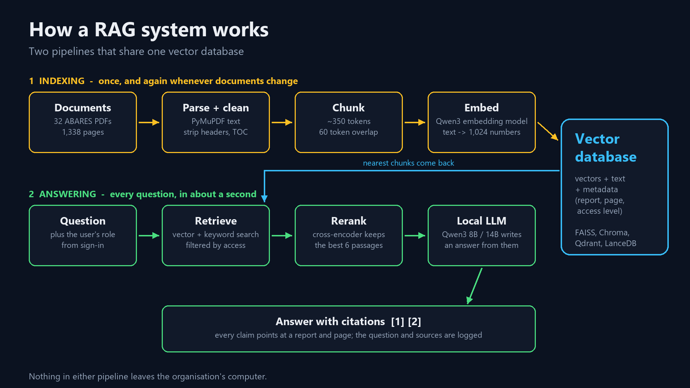
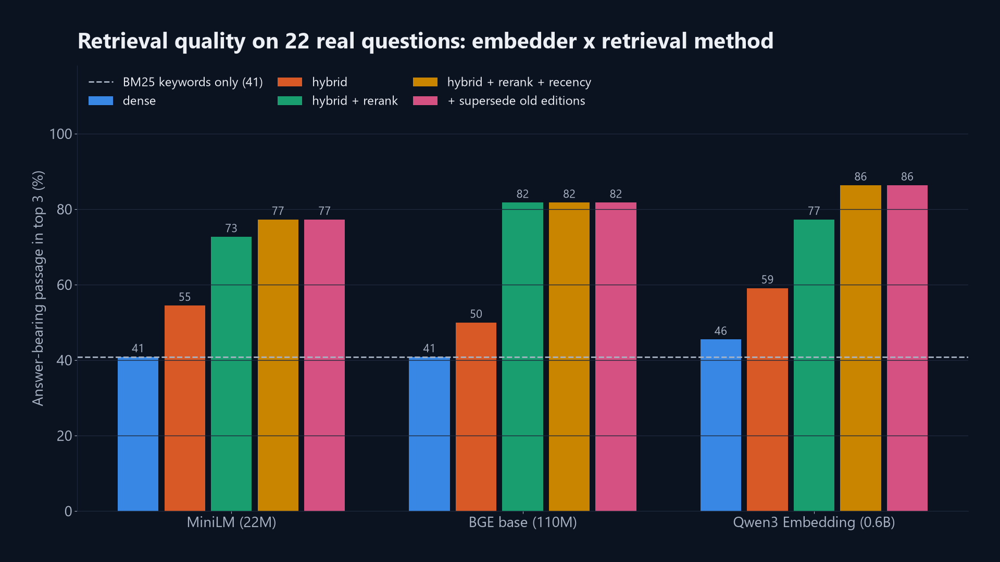

# RAG and vector databases: a private AI assistant for your organisation's documents

Code, evaluation set and step-by-step guide for the **GeoAI Lab** lecture (Series 2, episode 1).

* **Video:** [RAG and Vector Databases: Build a Private AI Assistant for Your Organisation's Documents](https://youtu.be/QGgdQjl7YRw) on the [GeoAI Lab YouTube channel](https://www.youtube.com/channel/UC_HGuLPYUpp3s9LMVaDIX0A)
* **Step-by-step guide:** [`STEP_BY_STEP.md`](STEP_BY_STEP.md)
* **Accuracy report:** [`RAG_ACCURACY_REPORT.md`](RAG_ACCURACY_REPORT.md)

A complete retrieval-augmented generation (RAG) system over **32 real Australian government agriculture
reports** (ABARES, 1,338 pages, CC BY 4.0), running entirely on one workstation with open-weight models:
no API keys, and no document or question ever leaves the machine.



## What is in here

| Step | Script | What it does |
|---|---|---|
| 0 | `code/00_download_data.py` | Downloads the 32 reports listed in `data/pdfs/manifest.csv` |
| 1 | `code/01_parse_chunk.py` | PDF text (PyMuPDF), clean-up, 350-token chunks with overlap, metadata + access level |
| 2 | `code/02_embed_index.py` | Embeds with 3 open models; builds FAISS (Flat, HNSW, IVF-PQ), Chroma, Qdrant, LanceDB; benchmarks them |
| 3 | `code/03_eval_retrieval.py` | Retrieval accuracy: BM25 vs dense vs hybrid vs reranked, per embedder |
| 4 | `code/04_eval_answers.py` | Answer accuracy: each LLM with and without RAG, refusals, access control |
| 5 | `code/05_figures.py` | The figures used in the video |
| - | `code/rag.py` | The engine: hybrid retrieval, reranking, recency prior, access filter, grounded generation |
| - | `code/app.py` | Gradio chat interface with roles, citations, sources panel and audit log |

## Quick start

```bash
python -m venv .venv && .venv\Scripts\activate        # Linux/macOS: source .venv/bin/activate
pip install torch --index-url https://download.pytorch.org/whl/cu128
pip install -r requirements.txt

cd code
python 00_download_data.py
python 01_parse_chunk.py
python 02_embed_index.py
python app.py                       # open http://127.0.0.1:7860
```

Optional: `python 03_eval_retrieval.py` and `python 04_eval_answers.py` reproduce the accuracy numbers.

**Hardware:** the LLM wants a GPU (Qwen3-8B in bf16 needs about 16 GB of VRAM; the 14B model about 30 GB).
Everything else runs on a CPU. Any chat model on Hugging Face can be added to `LLMS` in `code/common.py`. Models download from Hugging Face on first use; none require a token.

## Models (all open weights, run locally)

| Role | Model | Licence |
|---|---|---|
| Embeddings (default) | Qwen/Qwen3-Embedding-0.6B | Apache 2.0 |
| Embeddings (compared) | BAAI/bge-base-en-v1.5, sentence-transformers/all-MiniLM-L6-v2 | MIT / Apache 2.0 |
| Reranker | BAAI/bge-reranker-v2-m3 | Apache 2.0 |
| LLM (default) | Qwen/Qwen3-8B | Apache 2.0 |
| LLM (compared) | Qwen/Qwen3-14B | Apache 2.0 |

## Headline results

See [`RAG_ACCURACY_REPORT.md`](RAG_ACCURACY_REPORT.md) for the full, question-by-question results.



## Data and licence

Reports © Commonwealth of Australia (ABARES), licensed under Creative Commons Attribution 4.0 International
(one report: CC BY 3.0 AU). They are downloaded from the publisher by `00_download_data.py` rather than
redistributed here; `data/pdfs/manifest.csv` records the source URL and licence of each.
The access levels (public / internal / restricted) are a teaching device; all the reports are public.

Code: MIT licence (see `LICENSE`).
